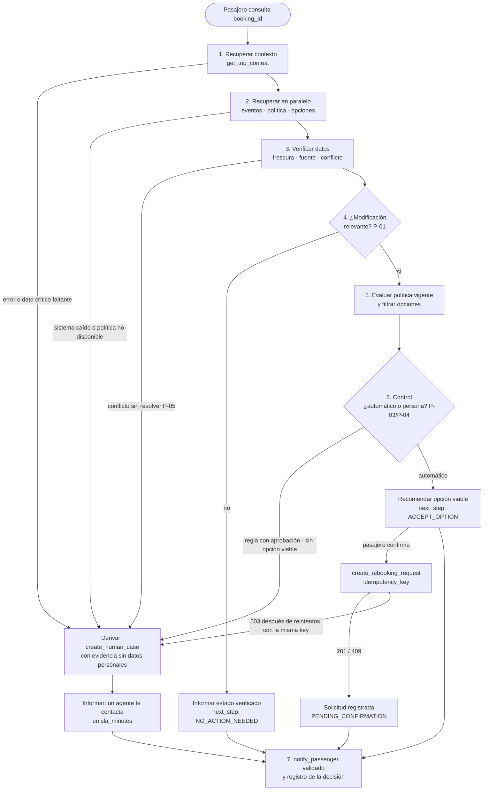

# 8. Flujo

Flujo deducido del enunciado. Las decisiones que dependen de una pregunta abierta citan su `P-XX`:
el flujo funciona igual con cualquier respuesta; sólo cambian los umbrales.

## 8.1 Flujo general (7 etapas)

- **Determinístico:** las etapas 1 a 6 completas.
- **Persona:** la salida "Derivar".
- **IA:** ninguna en runtime (ADR-009). La consulta se plantea con opciones cerradas y el mensaje se
  arma con una plantilla.

## 8.2 Caso base resuelto con los datos del enunciado (`ABC123`)

| Etapa | Dato | Resultado |
|---|---|---|
| 1. Contexto | 2 pasajeros (María ADULT, Tomás CHILD de 7 años) · S1 SCL→LIM 14:30–17:55 · S2 LIM→MEX 19:05–23:40 · `PARTIAL` (falta `change_penalty_amount`) | Grupo con un menor. El dato faltante **no es crítico** si el entitlement es sin costo (P-09) |
| 3. Verificación | S1: `DELAY` de 160 min (OPS_CORE, 10:48) frente a `ON_TIME` (LEGACY_MIRROR, 09:30, **degradada** y más antigua) | Se descarta LEGACY_MIRROR: **S1 sale con 160 min de retraso**, a las 17:10 (P-05) |
| | S1: `GATE_CHANGE` a la puerta 24 (AIRPORT_FEED) | Informativo |
| | S2: `SCHEDULED` (OPS_CORE) | Sin cambio |
| 4. Relevancia | Llegada estimada de S1 ≈ 17:55 + 160 min = **20:35**, posterior a la salida de S2 (19:05) | **Conexión perdida: es una modificación relevante.** Falta el tiempo mínimo de conexión y la zona horaria (P-07), pero en este caso se pierde igual |
| 5. Política `POL-DELAY-2026-03` | R1 (≥ 180 min): **no** (160) · R2 (≥ 240 min e internacional): **no** · R3 (conexión perdida): **sí** → `REBOOK_NO_FEE` · R4: sólo si el pasajero pide compensación (P-14) · R5 (menor en el grupo): **sí** → `PRIORITY_HANDLING`, **requiere aprobación humana** | Corresponde un cambio de vuelo sin costo y atención prioritaria con aprobación |
| 5. Opciones | O1 LA2412 del 16-09 a las 08:15, diferencia 0, 4 asientos, HIGH · O2 LA2450 del 15-09 a las 23:40, 180000 CLP, **1 asiento** · O3 REFUND, tarifa **no reembolsable**, LOW | **O1 es la única viable.** O2 se descarta (menos asientos que pasajeros y cobra diferencia pese al cambio sin costo). O3 se descarta (tarifa y confianza) (P-08) |
| 6. Control | R5 exige aprobación humana | Supuesto conservador: se informa y se recomienda O1 en automático (R3 no requiere aprobación) y **en paralelo** se crea un caso `APPROVAL_REQUIRED` por R5. La alternativa es enviar todo el caso a una persona (P-17) |
| 7. Comunicación | — | "Tu vuelo LA500 sale con retraso a las 17:10 y no alcanzarás tu conexión LA2410. Te corresponde un cambio sin costo: LA2412 del 16 de septiembre a las 08:15, para ambos pasajeros. Como viajas con un menor, un agente te contactará para darte atención prioritaria." + `policy_ref` |

**Hallazgo del caso base:** con O1, la llegada a México pasa al día siguiente (unas 13 h de retraso
a destino). Si el retraso se midiera a destino final (P-06), aplicarían también R1 y R2
(`MEAL_VOUCHER`). Además hay una noche en Lima y la política no tiene regla de hotel (P-15).

## 8.3 Consulta ambigua o compleja
Ejemplo: *"Mi vuelo está atrasado, ¿pierdo la conexión? Quiero que me compensen."*

| Paso | Qué hace | Clasificación |
|---|---|---|
| 1 | El pasajero elige "revisar mi conexión" y "pedir una compensación": `compensation_requested = true` | Determinístico (opciones cerradas) |
| 2 | Recuperar contexto, eventos, política y opciones | Determinístico |
| 3 | Calcular la conexión perdida y evaluar R1 a R5 | Determinístico |
| 4 | R4 (`CASH_COMPENSATION`) requiere aprobación: **el sistema se detiene** | Persona |
| 5 | Responder lo verificado (conexión perdida, O1) y derivar la compensación con evidencia | Determinístico (plantilla) |

**Dónde se detiene:** en el paso 4, porque R4 exige aprobación. Lo verificado (conexión perdida, O1)
se responde igual, y la compensación queda en manos de una persona. Si ninguna opción describe el
caso, el pasajero elige "hablar con una persona". No hay IA en runtime (ADR-009): la consulta compleja
se descompone con opciones cerradas y reglas, no con interpretación de texto.

## 8.4 Escalabilidad sin complejizar la V1
| Eje | V1 (lo mínimo) | Punto de extensión declarado |
|---|---|---|
| Nuevos escenarios (cancelación, desvío) | Sólo `DELAY` | Registro de evaluadores por escenario (`scenario → predicados por rule_id`). Agregar uno no toca el orquestador |
| Nuevas versiones de política | Predicados por `rule_id` y versión | Una regla desconocida va a una persona hasta tener su predicado: el sistema no falla, se vuelve conservador |
| Nuevas fuentes operacionales | Prioridad por estado (sana antes que degradada) y por recencia | Tabla configurable de confiabilidad por fuente |
| Volumen (disrupción masiva, muchas reservas a la vez) | Orquestador sin estado; lecturas en paralelo | Cache de lecturas que respeta `ttl_seconds`; cola para escrituras y notificaciones; escalado horizontal |
| Canales | `PUSH` vía `notify_passenger` | Plantillas por canal sobre el mismo `DisruptionAssessment` |
| Operación | Un único registro de decisiones | OV-1 y OV-2 se calculan desde el registro; el dashboard viene después |
