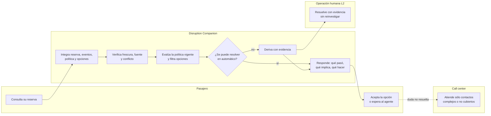

# 10. Estado actual (AS-IS), estado futuro (TO-BE) e impacto

El enunciado casi no describe cómo funciona hoy el negocio. Por eso el AS-IS es corto y cada
afirmación declara su origen. El peso del documento está en el **TO-BE** y en el **impacto** que se busca.

Origen de cada afirmación:
- **Evidencia:** está en el enunciado.
- **Inferencia:** se deduce razonablemente del enunciado.
- **Desconocido:** hay que preguntarlo.

---

## 10.1 AS-IS — lo que se sabe y lo que no

| # | Aspecto | Cómo es hoy | Origen |
|---|---|---|---|
| 1 | Datos del viaje y de la operación | Existen y se pueden consultar: reserva, eventos, opciones, políticas | Evidencia (los 7 sistemas disponibles) |
| 2 | Calidad de los datos | Las fuentes se contradicen (`OPS_CORE` frente a `LEGACY_MIRROR`), hay fuentes degradadas y respuestas parciales | Evidencia |
| 3 | Coexistencia con sistemas legados | Hay un espejo legado (`LEGACY_MIRROR`) todavía activo y degradado | Evidencia |
| 4 | Políticas | Están versionadas y cambian: `POL-DELAY-2025-11` fue reemplazada por `POL-DELAY-2026-03` | Evidencia |
| 5 | Operación humana | Existe una cola `DISRUPTION_L2` con un SLA de 45 min | Evidencia |
| 6 | Canal hacia el pasajero | Existen notificaciones `PUSH` | Evidencia |
| 7 | Cómo resuelve hoy el pasajero sus dudas | Contacta al call center | Inferencia (el objetivo es reducir esos contactos) |
| 8 | Quién combina datos y política | Una persona (agente) que consulta varios sistemas y aplica la política | Inferencia |
| 9 | Trazabilidad de lo ofrecido | No se sabe si queda registrado por qué se ofreció una opción | Desconocido (P-20) |
| 10 | Autoservicio actual en disrupciones | No se sabe si existe alguno ni qué cubre | Desconocido (P-20) |
| 11 | Volúmenes, tasa de contacto, costo por contacto, tiempo de atención y costo de un reclamo | No hay datos | Desconocido (P-19) |
| 12 | Cómo se entera hoy el pasajero de la modificación | No se sabe si recibe un aviso proactivo o si consulta él | Desconocido (P-22) |

### Problemas del AS-IS (inferidos)
- **La persona es el integrador.** Cada contacto obliga a reconstruir el caso desde cero.
- **El criterio varía.** La política se aplica según quién atiende; no hay una evaluación única ni trazable.
- **La respuesta es más lenta que la vigencia.** Las opciones duran 120 s y los asientos se agotan,
  mientras que la atención humana se mide en minutos (SLA de 45 min en L2).
- **La demanda llega en picos.** Una disrupción genera muchos contactos a la vez y la capacidad no escala.

---

## 10.2 TO-BE — cómo debería funcionar mañana

### Principio
**El sistema integra y decide lo determinístico; el pasajero se autoatiende; la persona se ocupa sólo
de lo que requiere criterio o aprobación.**

### Proceso futuro



### Comparación paso a paso

| Paso | AS-IS (inferido) | TO-BE | Impacto buscado | Tipo |
|---|---|---|---|---|
| Enterarse de la modificación | Por sus medios o por un aviso (P-22) | Consulta en el Companion y recibe la respuesta por `PUSH` | Menos incertidumbre | Experiencia |
| Entender qué pasó | Llama y un agente consulta varios sistemas | Una respuesta consolidada, verificada y con la hora del dato | Contactos evitados | Financiero |
| Saber qué le corresponde | Depende del agente | Evaluación determinística de la versión vigente, con `policy_ref` | Ni fuga de costo ni reclamos | Financiero y cumplimiento |
| Elegir una alternativa | El agente ofrece lo que encuentra | Sólo opciones viables para todo el grupo, dentro de su vigencia | Más aceptación, menos reversiones | Operativo |
| Ejecutar el cambio | Lo hace el agente | Solicitud idempotente con confirmación del pasajero | Sin duplicados ni cambios sin control | Operativo |
| Casos que requieren criterio | Llegan a L2 sin contexto estructurado (inferido) | Llegan a L2 con motivo y evidencia | Menos tiempo por caso | Operativo |
| Auditoría | No se sabe (P-20) | Registro de cada decisión | Cada caso se puede reconstruir | Cumplimiento |

### Qué no cambia
- El call center y la cola L2 siguen existiendo: cambia **qué** les llega, no si existen.
- La autoridad sobre compensaciones en dinero y sobre casos especiales sigue siendo humana.
- Las políticas las sigue definiendo el negocio; el producto las aplica, no las interpreta.

---

## 10.3 Impacto que se busca

| Dimensión | Impacto | Indicador |
|---|---|---|
| **Financiero: costo de atención** | Menos contactos evitables al call center | OV-1 |
| **Financiero: costo del error** | Ninguna fuga por otorgar de más ni reclamos por otorgar de menos | OV-2 |
| **Operativo: call center** | En los picos, la capacidad humana se concentra en lo complejo | OV-1, IA-1 |
| **Operativo: L2** | Menos tiempo por caso, porque la evidencia ya viene armada | IA-4 |
| **Cumplimiento** | Política aplicada en forma uniforme y trazable | % de decisiones con traza completa |
| **Experiencia** | Respuesta antes de que venzan las opciones | IA-2, IA-3 |

### Ejemplo concreto de fuga de costo evitada (con datos del enunciado)
La opción O2 tiene una diferencia de tarifa de 180000 CLP, pero al pasajero le corresponde un cambio
**sin costo**. Ofrecerla sin filtrar lleva a uno de dos resultados malos: se le cobra al pasajero algo
que no debería pagar (reclamo) o la aerolínea absorbe la diferencia (fuga de costo). Además, tiene un
solo asiento para dos pasajeros. El filtro determinístico de HU-004 evita ambos resultados.

---

## 10.4 Modelo de impacto financiero

Variables (todas por mes, todas a obtener en P-19):

| Variable | Significado |
|---|---|
| `N` | Reservas con modificación relevante atendidas por el Companion |
| `tc_base` | Tasa de contacto al call center sin el Companion (línea base) |
| `r` | Reducción relativa de la tasa de contacto lograda (OV-1) |
| `c_contacto` | Costo total de un contacto al call center |
| `N_auto` | Respuestas automáticas emitidas (`N × IA-1`) |
| `e` | Tasa de recomendación incorrecta (OV-2) |
| `c_error` | Costo medio de un error: corrección, reclamo y compensación |
| `c_interaccion` | Costo por interacción del Companion (infraestructura y modelo, si lo hay) |

```
Ahorro bruto     = N × tc_base × r × c_contacto
Costo del error  = N_auto × e × c_error
Costo operativo  = N × c_interaccion
Beneficio neto   = Ahorro bruto − Costo del error − Costo operativo
```

## 10.5 Punto de equilibrio del error: de dónde sale la meta de OV-2

La automatización conviene sólo si el costo de los errores no se come el ahorro:

```
e_max = (Ahorro bruto − Costo operativo) / (N_auto × c_error)
```

**Ejemplo con valores ficticios, sólo para mostrar el cálculo:**

| Variable | Valor ficticio |
|---|---|
| `N` | 10.000 reservas |
| `tc_base` | 40 % (4.000 contactos) |
| `r` | 20 % (800 contactos evitados) |
| `c_contacto` | USD 5 |
| `N_auto` | 7.000 respuestas (IA-1 = 70 %) |
| `c_error` | USD 100 |
| `c_interaccion` | ≈ 0 (núcleo determinístico, sin modelo) |

- Ahorro bruto = 800 × 5 = **USD 4.000 al mes**.
- `e_max` = 4.000 / (7.000 × 100) = **0,57 %**.
- Con `e` = 1 % (el marcador inicial de OV-2), el costo del error sería 70 × 100 = USD 7.000 y el
  beneficio neto, **−USD 3.000**.

**Conclusión:** con estos valores, una meta de error del 1 % destruiría el valor del producto. La meta
de OV-2 se calcula con los datos reales de P-19; no se elige a priori. Esto también justifica el
diseño conservador: **derivar a una persona baja `N_auto` y `e` al mismo tiempo**, y eso protege el
beneficio neto aunque reduzca la contención.

## 10.6 Impacto operativo (en horas, no en dinero)

```
Horas ahorradas en L2 = casos derivados con evidencia × (tiempo sin evidencia − tiempo con evidencia) / 60
```
Ejemplo ficticio: 2.000 casos al mes × 3 min ahorrados = **100 horas de agente al mes**, que se
reasignan a casos complejos. El valor real depende del tiempo de atención actual (P-19).
