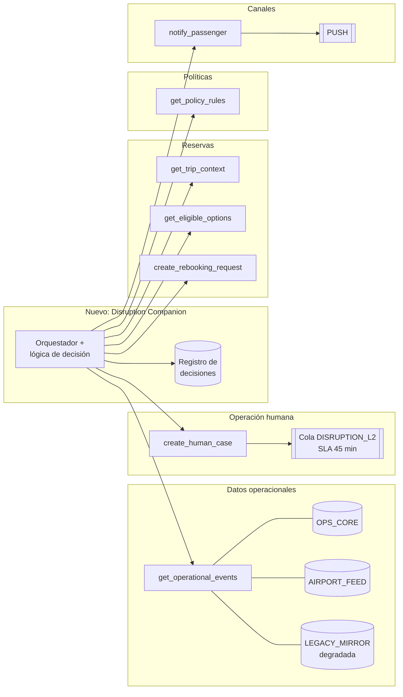

# 12. Sistemas y tecnología existente

Inventario de lo que ya existe según el enunciado, de lo que se puede inferir y de lo que falta saber
para integrarse. Cómo se consume cada sistema está en el documento 7.

## 12.1 Panorama

Los agrupamientos por dominio (reservas, operación, políticas) son una **inferencia** a partir del
tipo de dato; el enunciado sólo define las interfaces.

## 12.2 Inventario de sistemas

| Sistema | Tipo | Qué entrega o hace | Características conocidas | Lo que no se sabe |
|---|---|---|---|---|
| `get_trip_context(booking_id)` | Lectura | Pasajeros, segmentos, condiciones de tarifa y metadato de completitud | Puede ser `PARTIAL`; trae datos personales | Errores, latencia, autenticación, zona horaria de los horarios |
| `get_operational_events(segment_ids)` | Lectura | Eventos por segmento: `DELAY`, `GATE_CHANGE`, `STATUS` | Cada evento trae fuente y hora; informa fuentes disponibles y degradadas | Otros tipos de evento (cancelación, desvío), errores, frecuencia de actualización |
| `get_eligible_options(trip_context)` | Lectura | Opciones candidatas `REBOOK` o `REFUND` con `policy_ref` y `confidence` | Vigencia de 120 s; no es una decisión | Cómo calcula `confidence`; si reserva asientos; errores |
| `get_policy_rules(scenario)` | Lectura | Reglas versionadas por escenario | Versión, vigencia y versiones reemplazadas; condiciones como texto | Escenarios disponibles además de `DELAY`; lenguaje de las condiciones |
| `create_rebooking_request(option, idempotency_key)` | Escritura, alto impacto | Solicitud de cambio de vuelo | Idempotente; 201, 409 y 503 documentados; resultado `PENDING_CONFIRMATION` | Quién confirma; cómo consultar el estado de una solicitud después de un 503 |
| `create_human_case(reason, evidence)` | Escritura | Caso en la cola de operación | Devuelve cola y SLA | Si deduplica; formato de `evidence`; cómo vuelve la resolución |
| `notify_passenger(message)` | Escritura | Notificación al pasajero | Valida contenido (422 sin `policy_ref`); 202 = encolada | Confirmación de entrega; otros canales; plantillas existentes |

## 12.3 Fuentes de datos operacionales

| Fuente | Qué aporta en el ejemplo | Estado | Tratamiento propuesto (RD-05) |
|---|---|---|---|
| `OPS_CORE` | Retrasos y estado de los segmentos | Sana | Fuente principal para el estado del vuelo |
| `AIRPORT_FEED` | Cambio de puerta | Sana | Válida para datos de aeropuerto (puerta) |
| `LEGACY_MIRROR` | Estado `ON_TIME` antiguo (09:30) | **Degradada** | Se descarta si hay una fuente sana; nunca se muestra como verdad |

**Hallazgo:** la única contradicción del ejemplo viene de la fuente degradada y es la más antigua.
Por eso el caso base se resuelve sin intervención humana. El riesgo real son las contradicciones entre
dos fuentes sanas, que el ejemplo no trae y que RD-05 deriva a una persona.

## 12.4 Datos existentes y su clasificación

| Dato | Clasificación | Uso en el producto | Dónde puede ir |
|---|---|---|---|
| `name` | Personal | No se usa para decidir | Sólo al canal de notificación, si la plantilla lo requiere |
| `email`, `phone` | Personal, de contacto | No se usa para decidir | Sólo al canal de notificación |
| `document_id` | Personal, sensible | No se usa | No sale del adaptador de reserva |
| `loyalty_tier` | Personal, comercial | No se usa (ninguna regla lo considera) | No sale del adaptador |
| `type`, `age` | Personal, mínimo necesario | Composición del grupo (menor) | Sólo como indicador booleano `group_includes_minor` |
| `booking_id` | Identificador | Clave de la consulta | Registro (seudonimizado) y evidencia del caso |
| Segmentos, eventos, opciones, políticas | Operacional | Base de la decisión | Registro y evidencia |

## 12.5 Tecnología propia
**No existe.** El producto es nuevo: no hay código, stack ni infraestructura heredados que condicionen
la solución. Decisiones tomadas: ADR-001 (track Backend/Integración), ADR-002 (stack TypeScript +
Node) y ADR-009 (sin IA en runtime).

Lo que la V1 necesita como mínimo, sea cual sea el stack:

| Pieza | Para qué | Mínimo viable |
|---|---|---|
| Adaptadores de los 7 sistemas | Aislar los contratos externos y los datos personales | Un adaptador por sistema; en la V1, mocks con las respuestas del enunciado |
| Lógica de decisión | Consolidar, evaluar la política y filtrar opciones | Funciones puras testeables |
| Orquestador | Llamadas en paralelo, control de escrituras y derivación | Sin estado; el único que llama a los sistemas de escritura |
| Registro de decisiones | Traza y métricas | Un registro estructurado por consulta, sin datos personales |
| Plantillas de mensaje | Notificación validada | Plantillas versionadas con `policy_ref` |

## 12.6 Matriz de permisos propuesta (mínimo privilegio)

| Componente | Lee reserva | Lee eventos, opciones y políticas | Ve datos personales de contacto | Escribe (rebooking, caso, notificación) |
|---|---|---|---|---|
| Adaptador de reserva | Sí | No | Sí (los recibe) | No |
| Lógica de decisión | Sólo datos ya filtrados | Sí (vía adaptadores) | **No** | **No** |
| Orquestador | Vía adaptador | Vía adaptadores | No | **Sí, el único** |
| Frontend | No: consume el contrato de salida | No | No | No: pide la acción al orquestador |

## 12.7 Lo que falta saber para integrarse

| Tema | Por qué importa | Pregunta |
|---|---|---|
| Errores de los sistemas de lectura | Sin ellos no se puede diseñar la degradación con precisión | P-11 |
| Zona horaria de los horarios | Cálculo de la conexión perdida | P-07 |
| Autenticación, latencia, límites de uso y SLA de cada sistema | Presupuesto de latencia y reintentos | P-24 |
| Consultar el estado de una solicitud después de un 503 | Reconciliación sin depender de un reintento | P-12 |
| Disparador de eventos para avisar en forma proactiva | La V1 sólo responde cuando el pasajero consulta | P-22 |
| Política de reembolso `POL-REFUND-2026-01` | O3 la cita y no está disponible | P-23 |
