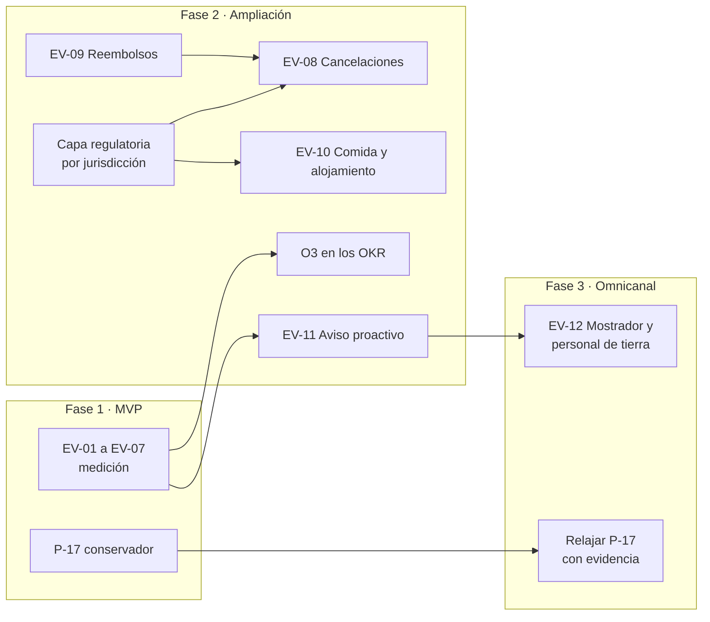

# 15. Evolución y recomendaciones posteriores al desafío

Qué conviene considerar **después** de cubrir el alcance del desafío, tomando como insumo la
evaluación de un experto de la industria aeronáutica en Latinoamérica (`Evaluadores/evaluador-profesional-latam.md`).
El informe mira el producto desde la operación real: regulación por país, sistemas legados, varios
canales y escalamientos. Varias de sus propuestas quedan **fuera del alcance del enunciado**, pero son
valiosas como evolución.

## 15.1 Criterio para incorporar una evolución
Una evolución pasa al backlog sólo si cumple las cuatro condiciones:

1. **Tiene una fuente de verdad:** una política, un dato o un sistema que la sostenga. Sin eso, sería
   inventar una regla.
2. **Tiene dueño:** alguien del negocio que valide su comportamiento.
3. **Tiene una métrica:** se puede saber si funcionó.
4. **No rompe un límite:** no aumenta el riesgo de error ni de acción sin control por encima de lo
   que tolera la economía del producto (documento 10, §10.5).

## 15.2 Qué se toma del informe y qué no

| Propuesta del informe | Decisión | Motivo |
|---|---|---|
| Medir la autogestión (adopción) | **Se toma** | Es un hueco real: hoy no se mide cuántos pasajeros afectados usan la solución |
| 0 rechazos por contenido no validado | **Se toma** | Es un límite barato de medir |
| Idempotencia en todas las transacciones | **Se toma, reformulada** | "100 % exitosa" no es controlable, porque el 503 es indeterminado por diseño. Se mide "0 duplicados" y "100 % de los 503 reconciliados o derivados" |
| Cumplir el SLA de los casos derivados | **Se toma** | El producto le promete al pasajero un SLA: si no se cumple, el mensaje se vuelve falso |
| Mejorar la satisfacción en disrupción | **Se toma, reformulada** | Sí como KR, pero con la meta fijada sobre una línea base, no con +15 puntos a priori |
| Prevenir multas regulatorias | **Se toma** | Las multas forman parte del costo del error |
| Aprobación humana obligatoria para grupos con menores | **Se evalúa** | Coincide con la alternativa conservadora de P-17 |
| Incluir cancelaciones | **Fase 2** | Necesita la política y los tipos de evento correspondientes |
| Reducir filas en el mostrador del aeropuerto | **Fase 3** | Es otro canal; conviene reutilizar el mismo motor de decisión |
| Aplicar las reglas "como marca la regulación" | **Fase 2, como fuente versionada** | La regulación entra como insumo de la política, nunca como lógica en código |
| "Cero errores en la comunicación" como objetivo | **No se toma** | Una meta absoluta empuja a no medir. Se mantiene el límite derivado de la economía y 0 acciones sin control |

---

## 15.3 Evolución de la medición (bajo costo, apta para la fase 1)
No requieren funcionalidades nuevas: salen del registro de decisiones y de los sistemas existentes.

| ID | Evolución | Fórmula | Por qué | Dueño | Depende de |
|---|---|---|---|---|---|
| EV-01 | **Adopción en disrupción** | Pasajeros con modificación relevante que consultan el Companion ÷ pasajeros con modificación relevante | Si nadie lo usa, la reducción de contactos no se produce aunque las respuestas sean perfectas | PM | Volumen total de disrupciones (P-19). Si no hay aviso proactivo (P-22), la adopción va a ser baja |
| EV-02 | **Rechazos por contenido no validado** | Respuestas 422 `UNVALIDATED_CONTENT` ÷ notificaciones enviadas. Meta: 0 | Un 422 es un error propio: el producto envió algo sin validar | Team Lead | — |
| EV-03 | **Solicitudes duplicadas** | Reservas con más de una solicitud de cambio activa para el mismo intento. Meta: 0 | Es el riesgo que la idempotency key tiene que eliminar | Team Lead | Consultar el estado de una solicitud (P-12) |
| EV-04 | **Reconciliación de resultados indeterminados** | 503 resueltos (por reintento con la misma key o por derivación) ÷ 503 recibidos. Meta: 100 % | Ningún pasajero puede quedar sin saber si su cambio se hizo | Team Lead | — |
| EV-05 | **Cumplimiento del SLA comunicado** | Casos derivados atendidos dentro de `sla_minutes` ÷ casos derivados | El producto promete "un agente te contacta en 45 min"; si L2 no cumple, la promesa es falsa | Operación L2 (el producto mide; L2 cumple) | Que el resultado del caso vuelva al Companion (documento 12, §12.2) |
| EV-06 | **Satisfacción en disrupción** | Encuesta breve después de la respuesta, comparada con el grupo de control | Mide OE-4, que hoy no tiene un KR | PM + CX | Línea base de satisfacción en disrupción |
| EV-07 | **Multas en el costo del error** | `c_error` = corrección + reclamo + compensación + **multa regulatoria esperada** | Una sola multa puede mover el punto de equilibrio del error | Finanzas + Legal | P-19, P-21 |

**Efecto de EV-05 en el diseño:** si el cumplimiento del SLA baja, el mensaje al pasajero debería
dejar de prometer un tiempo fijo y usar el SLA real observado. Es una regla nueva y la tiene que
validar el negocio.

**Efecto de EV-07 en el diseño:** si `c_error` sube por las multas, `e_max` baja y se justifica
derivar más casos a una persona. El modelo del documento 10 ya lo soporta; sólo cambia el valor.

## 15.4 Evolución de los OKR
Se propone sumar un **O3**, tomado del informe, cuando la integración con L2 permita medirlo:

**O3 · Resolver a tiempo lo que el sistema deriva a una persona**

| KR | Resultado clave | Tipo | Meta |
|---|---|---|---|
| KR3.1 | Cumplimiento del SLA comunicado (EV-05) | Resultado | Por lo menos 95 % dentro de `sla_minutes` (supuesto) |
| KR3.2 | Satisfacción en disrupción (EV-06) | Resultado | Mejora frente a la línea base; se fija la meta después de medirla |
| KR3.3 | Casos derivados resueltos sin recontactar al pasajero (hoy KR2.2) | Resultado | Por lo menos 80 % (supuesto) |

Y reforzar los límites de O1 y O2 con EV-02, EV-03 y EV-04.

---

## 15.5 Evolución funcional

### EV-08 · Cancelaciones (fase 2)
- **Qué:** el escenario `CANCELLATION`, con su política y sus entitlements.
- **Precondiciones:** que `get_policy_rules("CANCELLATION")` exista; que `get_operational_events` entregue el tipo de evento; que el dueño de las políticas valide.
- **Cómo escala:** se registra un evaluador nuevo por escenario (documento 8, §8.4). El orquestador no cambia.
- **Riesgo:** una cancelación afecta a todo el itinerario y suele combinar reembolso y cambio de vuelo. Va primero en modo sombra.

### EV-09 · Reembolsos (fase 2)
- **Qué:** ofrecer `REFUND` cuando una política lo habilite.
- **Precondiciones:** contar con la política `POL-REFUND-2026-01` (P-23). Además, el reembolso pasa a ser una **acción de alto impacto**, como lo plantea el informe: necesita la misma idempotencia y el mismo control que el cambio de vuelo.
- **Riesgo:** es dinero que sale. En la primera versión, siempre con aprobación humana.

### EV-10 · Asistencia: comida y alojamiento (fase 2)
- **Qué:** ejecutar `MEAL_VOUCHER` (R2) y cubrir la pernocta (P-15), que el informe menciona como parte de las obligaciones.
- **Precondiciones:** un sistema que emita el voucher o la reserva de hotel (hoy no existe, documento 12), una regla de alojamiento en la política y una definición de cómo se mide el retraso (P-06).
- **Hallazgo relacionado:** en el caso base, el retraso a destino final con O1 es de unas 13 h. Si el retraso se mide a destino, R1 y R2 aplican, y la pernocta es real.

### EV-11 · Aviso proactivo (fase 2, **prerrequisito de la adopción**)
- **Qué:** que el pasajero reciba la evaluación sin tener que consultar.
- **Precondiciones:** una suscripción o un disparador de eventos operacionales (P-22).
- **Por qué es prioritaria:** sin ella, EV-01 queda limitada a los pasajeros que ya buscan información, y la reducción de contactos tiene un techo bajo.
- **Riesgo:** en una disrupción masiva genera un pico de evaluaciones. Hacen falta una cola, una cache que respete la vigencia y un control de frecuencia por reserva.

### EV-12 · Canal aeropuerto: mostrador y personal de tierra (fase 3)
- **Qué:** que el agente en el mostrador vea la misma evaluación que el pasajero.
- **Por qué:** el informe lo pide para reducir las filas. El valor adicional es que **el mismo motor de decisión sirve a todos los canales**: el criterio es único, sea cual sea el lugar donde se atiende al pasajero.
- **Cómo escala:** un consumidor más del contrato de salida `DisruptionAssessment`. No requiere lógica nueva.
- **Precondiciones:** las herramientas del personal de tierra y sus permisos (P-30). El agente ve más datos que el pasajero, así que hace falta una matriz de permisos por rol.

---

## 15.6 Capa regulatoria (fase 2)

El informe parte de una realidad que el enunciado no menciona: **cada país tiene su propia regulación
de derechos del pasajero**. Nombra a Aerocivil (Colombia), ANAC (Brasil), JAC (Chile) y AFAC/PROFECO
(México).

### Recomendación: la regulación entra como **política versionada por jurisdicción**, nunca como código

```
get_policy_rules(scenario, jurisdiction)  →  política vigente para ese escenario y ese país
```

| Principio | Por qué |
|---|---|
| El dueño de las políticas (con Legal) publica una versión por jurisdicción | Mantiene una única fuente de verdad, versionada y verificable, como exige el enunciado |
| El motor no "sabe" de regulación: evalúa reglas | Un cambio regulatorio es una versión nueva de la política, no un despliegue de código |
| Cada entitlement cita la política **y la jurisdicción** | La trazabilidad sirve también como evidencia ante una autoridad |

### El problema que hay que resolver primero (P-29)
El caso base recorre **Chile → Perú → México**. Perú no figura en la lista del informe, y el informe
tampoco dice qué regulación aplica en un itinerario que cruza varios países:
- ¿La del país de origen del segmento afectado?
- ¿La del país de venta del pasaje?
- ¿La más favorable al pasajero?

Es una pregunta legal que se responde **antes** de construir la capa. Hasta entonces, se mantiene
el supuesto de que la política interna ya incorpora la regulación (P-21).

### Ruta propuesta
1. Legal confirma si `POL-DELAY-2026-03` ya cubre las regulaciones de la ruta (P-21).
2. Si no, se define la regla de jurisdicción para itinerarios de varios países (P-29).
3. Se agrega la dimensión `jurisdiction` al contrato de políticas.
4. Se valida en modo sombra con casos reales de cada país antes de exponer al pasajero.

---

## 15.7 Revisión de P-17 (grupos con menores)
El informe lee R5 como "aprobación humana obligatoria" para el caso completo. Nuestra propuesta
(RD-13) recomienda la opción en automático y deriva la atención prioritaria en paralelo.

**Recomendación de evolución:**
1. **Fase 0 (modo sombra) y piloto:** aplicar la lectura **conservadora**. Con un menor en el grupo,
   todo el caso va a una persona antes de comunicar la opción.
2. **Medir:** cuántas veces el agente confirma la opción que el sistema habría recomendado.
3. **Relajar con evidencia:** si la coincidencia es alta y el dueño de la política lo aprueba, pasar
   a la lectura en paralelo para reducir la carga de L2.

Así se empieza con el criterio del evaluador y sólo se automatiza cuando hay datos que lo justifican.

> **Nota sobre la POC (`v0.1.0-poc`):** la POC del desafío implementa la lectura **en paralelo**
> (P-17, decidida para el desafío). La lectura conservadora sigue siendo la recomendación para el
> **piloto productivo**, y la decide el dueño de la política. Ojo: no equivale a marcar R3 con
> aprobación humana, porque eso derivaría *todos* los cambios de pasaje y no sólo los grupos con
> menores. Hace falta una condición combinada en la política o una regla nueva (pregunta P-17b).

---

## 15.8 Hoja de ruta de la evolución



| Fase | Evoluciones | Condición de entrada |
|---|---|---|
| **1 · MVP** | EV-01 a EV-07 y P-17 conservador | El MVP está en piloto con el registro de decisiones funcionando |
| **2 · Ampliación** | EV-11 → EV-08, EV-09, EV-10, capa regulatoria y O3 | Disparador de eventos (P-22), políticas disponibles (P-23, P-15) y respuesta legal (P-21, P-29) |
| **3 · Omnicanal** | EV-12 y la relajación de P-17 | El motor está estable en el canal digital y hay evidencia del modo sombra |

**Orden recomendado dentro de la fase 2:**
1. **EV-11 primero**, porque sin aviso proactivo las demás evoluciones llegan a pocos pasajeros.
2. **La capa regulatoria antes que las cancelaciones y la asistencia**, porque esos escenarios son los
   que más dependen de la regulación.

---

## 15.9 Riesgos de la evolución

| Riesgo | Mitigación |
|---|---|
| Crecer en escenarios sin políticas disponibles | Criterio 15.1: sin fuente de verdad no se construye |
| Que la regulación termine escrita en código | Política versionada por jurisdicción (§15.6) |
| Que la omnicanalidad duplique la lógica | Un solo motor y un solo contrato de salida para todos los canales |
| Que el aviso proactivo sature los sistemas en una disrupción masiva | Cola, cache por vigencia y control de frecuencia por reserva |
| Que relajar P-17 aumente los errores | Sólo con evidencia del modo sombra y aprobación del dueño de la política |

## 15.10 Preguntas nuevas que surgen de este documento
Propuestas para sumar al documento 9:

| ID | Pregunta | A quién |
|---|---|---|
| P-29 | En un itinerario que cruza varios países (Chile → Perú → México), ¿qué regulación aplica: origen del segmento, país de venta o la más favorable? | Legal |
| P-30 | ¿Qué herramientas y permisos tiene hoy el personal de tierra y el mostrador? | Operación de aeropuerto |
| P-31 | ¿Existe un sistema para emitir vouchers de comida y reservas de hotel? | Operación + Plataforma |
| P-32 | ¿Vuelve al Companion el resultado del caso derivado (hora de atención y resolución)? | Operación L2 + Plataforma |
