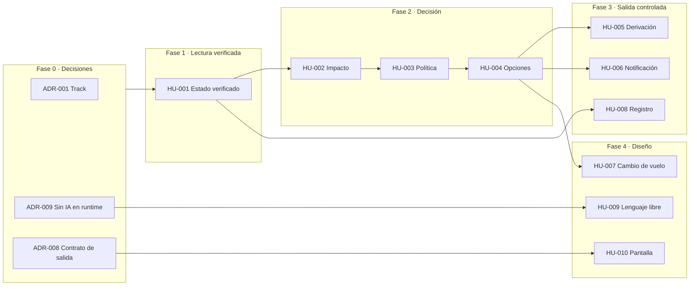

# EP-01 · Asistencia al pasajero ante una modificación de vuelo

- **Estado:** Borrador (propuesta para revisión)
- **Tipo de documento:** definición de la épica y mapa de ruta. De aquí se derivan las historias de
  usuario (HU) y los registros de decisión de arquitectura (ADR).
- **Base:** documentos 01 a 09 de esta carpeta `Docs/`.

---

## 1. Descripción

Cuando un vuelo de la reserva sufre una modificación, el pasajero consulta su reserva y el sistema
le dice **qué pasó, qué le implica y cuál es su siguiente paso**: aceptar una opción de cambio, esperar
a un agente o no hacer nada. Para eso combina la reserva, los eventos operacionales y la política
vigente, con lógica determinística, y deriva a una persona todo lo que no puede decidir con seguridad.

La épica cubre las cuatro capacidades que pide el enunciado para la V1:

| Capacidad del enunciado | HU que la entregan |
|---|---|
| C1. Consultar el contexto del viaje | HU-001 |
| C2. Entender si hubo una modificación relevante y qué implica | HU-001, HU-002 |
| C3. Recibir una explicación o recomendación accionable | HU-003, HU-004, HU-006 |
| C4. Ser derivado a una persona o iniciar una acción controlada | HU-005, HU-007 |
| Transversal: trazabilidad y medición | HU-008 |
| Consulta ambigua o compleja (§5.2 del enunciado) | HU-009 |
| Capa complementaria al track (§5.3 del enunciado) | HU-010 |

## 2. Objetivo y métricas

- **Objetivo:** que todo pasajero con una modificación en su viaje sepa, sin llamar, qué pasó y cuál
  es su siguiente paso, con información verificada y trazada a la política vigente (documento 2).
- **OV-1 · Contención (resultado):** tasa de contacto al call center dentro de las 24 h siguientes a
  la respuesta. Meta supuesta: −20 % frente a la línea base (P-16).
- **OV-2 · Exactitud (límite):** tasa de recomendación incorrecta. Su meta se deriva del punto de
  equilibrio entre el ahorro por contacto y el costo por error (documento 10, §10.5); el 1 % es sólo un
  marcador. Además, **0 acciones de alto impacto sin control** (meta absoluta).
- **Indicadores adelantados:** IA-1 a IA-4 (documento 5), medibles desde el día 1 con HU-008.
- **OKR:** esta épica es la iniciativa principal de O1 y O2 (documento 14, §14.4).

Ambas se calculan desde el registro de decisiones (HU-008).

## 3. Alcance

**Incluye**
- Escenario `DELAY` y su consecuencia, la conexión perdida: es la única política del enunciado.
- La reserva completa como unidad (todos los pasajeros del booking).
- Recomendación de cambio de vuelo sin costo, filtrada contra la política, el grupo y la vigencia.
- Derivación a una persona con evidencia, y notificación sólo con contenido validado.
- Solicitud de cambio de vuelo controlada (como diseño o pseudocódigo, según el corte de la §7).

**No incluye**
- Cancelación, desvío o cambio de equipo: no hay política ni tipo de evento en el enunciado.
- Compensación en dinero automática: la regla R4 exige aprobación humana.
- Confirmación y emisión final del nuevo ticket (P-10).
- Hotel o alojamiento por pernocta (P-15).
- Chat libre de varios turnos, varios canales y dashboard de métricas.

## 4. Definiciones de la épica

### 4.1 Estados del viaje (`trip_status`)
| Estado | Cuándo | Siguiente paso típico |
|---|---|---|
| `NO_CHANGE` | Hay eventos verificados de fuentes sanas y ninguno modifica el viaje | `NO_ACTION_NEEDED` |
| `INFORMATIVE_CHANGE` | Sólo hay cambios que no afectan el itinerario (por ejemplo, `GATE_CHANGE`) | `NO_ACTION_NEEDED` con aviso |
| `RELEVANT_CHANGE` | Supuesto P-01: el cambio activa una regla de la política o hace perder una conexión | `ACCEPT_OPTION` o `WAIT_FOR_AGENT` |
| `UNVERIFIED` | No hay eventos, todas las fuentes están degradadas o falló una lectura | `WAIT_FOR_AGENT` |

`UNVERIFIED` existe para no afirmar nunca "sin cambios" cuando en realidad no se sabe.

### 4.2 Siguiente paso (`next_step`)
`ACCEPT_OPTION` (hay una opción viable que el pasajero puede aceptar) · `WAIT_FOR_AGENT` (se creó un
caso humano; se informa el SLA) · `NO_ACTION_NEEDED`. Toda respuesta tiene exactamente uno.

### 4.3 Motivos de derivación (`reason` de `create_human_case`)
| Código | Cuándo |
|---|---|
| `APPROVAL_REQUIRED` | Aplica una regla con `requires_human_approval: true` (R4, R5) |
| `SOURCE_CONFLICT` | Dos fuentes sanas se contradicen en un hecho que cambia la decisión |
| `INCOMPLETE_DATA` | Falta un dato crítico del contexto del viaje |
| `NO_VIABLE_OPTION` | Ninguna opción candidata sobrevive al filtro |
| `UNSUPPORTED_RULE` | La política vigente trae una regla que el sistema no sabe evaluar |
| `REBOOKING_INDETERMINATE` | El cambio de vuelo sigue indeterminado después de los reintentos |
| `READ_FAILURE` | Falló un sistema de lectura o la política no está disponible |

### 4.4 Supuestos con los que se escriben los criterios
Para que los criterios de aceptación se puedan verificar, se fija un valor por defecto para cada
pregunta abierta. Si la respuesta a esa pregunta cambia, se ajusta el parámetro y el criterio, no el diseño.

| Pregunta | Valor por defecto | Tipo |
|---|---|---|
| P-01 Modificación relevante | Activa una regla de la política o hace perder una conexión | Regla |
| P-05 Fuentes en conflicto | Se descarta la fuente degradada si hay una sana; entre sanas gana la más reciente; si dos sanas se contradicen, se deriva | Regla |
| P-05 Frescura | Umbral configurable `max_event_age_minutes`, por definir con Operaciones | Parámetro |
| P-06 Medición del retraso | Por segmento | Regla |
| P-07 Conexión perdida | `llegada estimada + MCT > salida del segmento siguiente`; MCT configurable (por defecto 0); llegada estimada = llegada programada + `delay_minutes`; mismo huso horario por aeropuerto | Parámetro |
| P-08 Filtro de opciones | Asientos ≥ pasajeros; sin diferencia de tarifa si el entitlement es sin costo; sin reembolso si la tarifa no es reembolsable; `LOW` no se ofrece en automático | Regla |
| P-09 Dato faltante | `change_penalty_amount` no es crítico si el entitlement es `REBOOK_NO_FEE` | Regla |
| P-12 Idempotency key | `hash(booking_id + option_id + policy_version + passenger_ids ordenados)` | Regla |
| P-12 Reintentos ante 503 | 2 reintentos con la misma key y espera creciente | Parámetro |
| P-13 Condiciones de la política | Un predicado en código por `rule_id`; una regla desconocida no se aplica y se deriva | Regla |
| P-17 R3 y R5 a la vez | Se recomienda O1 en automático y se deriva R5 en paralelo | Regla |

---

## 5. Historias de usuario

Los criterios usan los datos de ejemplo del enunciado (reserva `ABC123`) cuando se puede, para que
cada uno sea un test directo. Los marcados **(neg)** cubren el camino de falla o el borde.

### HU-001 · Ver el estado verificado de mi viaje
> Como pasajero, quiero ver el estado actual de mis vuelos con datos verificados, para no actuar con
> información desactualizada o contradictoria.

**Capacidad:** C1, C2 · **Prioridad:** Alta · **Estimación:** 30 min · **ADR:** ADR-003, ADR-007

**Criterios de aceptación**
1. Dado el booking `ABC123`, cuando consulto, entonces obtengo los 2 segmentos (S1, S2) y la
   composición del grupo (1 adulto, 1 menor), sin `email`, `phone` ni `document_id` en la respuesta.
2. Dado que el contexto llega `PARTIAL` sin `change_penalty_amount`, cuando consulto, entonces la
   respuesta informa `completeness: PARTIAL` y el campo faltante, y la consulta continúa porque el campo no es crítico.
3. Dado que S1 tiene `DELAY` de 160 min de `OPS_CORE` (10:48) y `ON_TIME` de `LEGACY_MIRROR` (09:30,
   degradada), cuando se consolidan los eventos, entonces el estado de S1 es "retrasado, nueva salida
   17:10" y el evento E-1012 aparece como descartado con motivo "fuente degradada".
4. Dado el `GATE_CHANGE` a la puerta 24, cuando se consolidan los eventos, entonces se informa como
   cambio informativo con su fuente y su hora.
5. Todo hecho que se muestra al pasajero lleva la hora del dato ("según datos de las 10:48").
6. **(neg)** Dado que dos fuentes sanas informan estados incompatibles para el mismo segmento, cuando
   se consolidan, entonces el estado es `UNVERIFIED` y se deriva con `SOURCE_CONFLICT`.
7. **(neg)** Dado un evento más antiguo que `max_event_age_minutes`, entonces se informa con su hora
   y no habilita ninguna recomendación ni acción.
8. **(neg)** Dado que no llegan eventos para un segmento, o que todas sus fuentes están degradadas,
   entonces el estado es `UNVERIFIED` y nunca `NO_CHANGE`.
9. **(neg)** Dado que `get_trip_context` falla o expira, entonces no se emite ninguna recomendación y
   se deriva con `READ_FAILURE`.
10. **(neg)** Dado un booking que no pertenece a quien consulta, o que no existe, entonces la
    respuesta es la misma en ambos casos y no revela si la reserva existe.

### HU-002 · Saber si la modificación me afecta
> Como pasajero, quiero saber si el cambio afecta mi itinerario, por ejemplo si pierdo mi conexión,
> para entender qué me implica.

**Capacidad:** C2 · **Prioridad:** Alta · **Estimación:** 20 min · **ADR:** ADR-003

**Criterios de aceptación**
1. Dado S1 con 160 min de retraso (llegada estimada 20:35) y S2 con salida a las 19:05, cuando se
   calcula el impacto, entonces `missed_connection = true` y `trip_status = RELEVANT_CHANGE`.
2. Dado que sólo existe el `GATE_CHANGE`, entonces `trip_status = INFORMATIVE_CHANGE`.
3. Dado que todos los segmentos están `SCHEDULED` u `ON_TIME` según fuentes sanas y frescas, entonces
   `trip_status = NO_CHANGE`.
4. Dado un retraso que deja la llegada estimada antes de la salida siguiente con el MCT configurado,
   entonces `missed_connection = false`.
5. El impacto informa `delay_minutes` por segmento y la llegada estimada, y declara que el cálculo
   supone la duración de vuelo sin cambios.
6. **(neg)** Dado un segmento con estado `UNVERIFIED`, entonces no se calcula la conexión a partir de
   él y el viaje queda `UNVERIFIED`.

### HU-003 · Saber qué me corresponde según la política vigente
> Como pasajero, quiero saber qué me corresponde por la modificación, para no pedir ni de más ni de menos.

**Capacidad:** C3 · **Prioridad:** Alta · **Estimación:** 25 min · **ADR:** ADR-004

**Criterios de aceptación**
1. Dado el caso base (160 min, conexión perdida, grupo con un menor, sin pedido de compensación),
   cuando se evalúa `POL-DELAY-2026-03`, entonces aplican R3 (`REBOOK_NO_FEE`, sin aprobación) y R5
   (`PRIORITY_HANDLING`, con aprobación), y **no** aplican R1, R2 ni R4.
2. Cada entitlement de la respuesta cita su `policy_ref` y su `rule_id` (`POL-DELAY-2026-03/R3`).
3. Dado un retraso de 250 min en un segmento internacional, entonces aplican R1 y R2.
4. Dado que el pasajero pidió una compensación, entonces aplica R4 (`CASH_COMPENSATION`) y queda
   marcada como pendiente de aprobación; nunca se ofrece como otorgada.
5. **(neg)** Dada una política cuya versión figura en `superseded_versions` o cuya `effective_from` es
   posterior a la fecha del viaje, entonces no se usa y se deriva con `READ_FAILURE`.
6. **(neg)** Dada una política vigente con un `rule_id` sin predicado en el sistema, entonces esa regla
   no se aplica en automático y se deriva con `UNSUPPORTED_RULE`; el resto de las reglas se evalúa igual.
7. **(neg)** Dado que `get_policy_rules` no responde, entonces no hay entitlement ni recomendación y
   se deriva con `READ_FAILURE`.
8. La evaluación es una función pura: mismos hechos y misma versión de política producen siempre el
   mismo resultado (se verifica con test).

### HU-004 · Recibir una opción de cambio válida para todo mi grupo
> Como pasajero, quiero que me ofrezcan sólo opciones que sirvan para todos los que viajamos y que
> respeten lo que me corresponde, para no aceptar algo que después no se puede cumplir.

**Capacidad:** C3 · **Prioridad:** Alta · **Estimación:** 25 min · **ADR:** ADR-005

**Criterios de aceptación**
1. Dadas las opciones O1, O2 y O3 del enunciado y el entitlement `REBOOK_NO_FEE`, cuando se filtran,
   entonces la única recomendada es **O1** (LA2412, 16-09, 08:15, válida para los 2 pasajeros).
2. O2 aparece descartada con dos motivos: asientos insuficientes (1 para 2 pasajeros) y diferencia de
   tarifa (180000 CLP) incompatible con el cambio sin costo.
3. O3 aparece descartada con dos motivos: tarifa no reembolsable y confianza `LOW`.
4. Las opciones descartadas nunca llegan al mensaje del pasajero; sólo quedan en el registro.
5. La recomendación informa hasta cuándo es válida (`retrieved_at + ttl_seconds`).
6. **(neg)** Dadas opciones con el TTL vencido al momento de responder, entonces se vuelven a pedir una
   vez; si siguen vencidas o la lectura falla, no se recomienda ninguna y se deriva con `READ_FAILURE`.
7. **(neg)** Dada una opción cuyo `policy_ref` no coincide con la versión vigente, entonces se descarta.
8. **(neg)** Dado que ninguna opción sobrevive al filtro, entonces `next_step = WAIT_FOR_AGENT` y se
   deriva con `NO_VIABLE_OPTION`.
9. Dadas varias opciones viables, se ordenan por menor costo para el pasajero, luego por llegada más
   temprana y luego por `confidence`.

### HU-005 · Ser derivado a una persona con mi caso ya explicado
> Como pasajero, quiero que, cuando el sistema no pueda resolver solo, me derive a una persona que ya
> conozca mi caso, para no tener que explicarlo de nuevo.
> Como agente de operación, quiero recibir el caso con su evidencia, para resolverlo sin volver a investigar.

**Capacidad:** C4 · **Prioridad:** Alta · **Estimación:** 15 min · **ADR:** ADR-005, ADR-007

**Criterios de aceptación**
1. Dado el caso base, cuando aplica R5, entonces se crea un caso `APPROVAL_REQUIRED` **en paralelo** a
   la recomendación de O1 (supuesto P-17).
2. La evidencia incluye `decision_id`, `booking_id`, eventos usados y descartados, `policy_ref` con
   `rule_ids` y opciones evaluadas con su motivo; **no** incluye `email`, `phone` ni `document_id`.
3. Dada la respuesta 201 con `sla_minutes: 45`, entonces el pasajero recibe como siguiente paso "un
   agente te contacta en 45 min o menos".
4. `reason` siempre es un código del catálogo de la §4.3, nunca texto libre.
5. **(neg)** Dada una segunda consulta con el mismo `decision_id`, entonces no se crea un caso duplicado.
6. **(neg)** Dado que `create_human_case` falla, entonces el pasajero recibe la información verificada
   y un canal de contacto alternativo, y la falla queda en el registro; nunca se le informa un caso
   que no existe.

### HU-006 · Recibir una notificación clara y validada
> Como pasajero, quiero recibir un aviso con lo que pasó y qué hacer, en lenguaje simple, para decidir
> sin llamar.

**Capacidad:** C3 · **Prioridad:** Media · **Estimación:** 10 min (contrato y plantilla) · **ADR:** ADR-007

**Criterios de aceptación**
1. Dado el caso base, el mensaje dice: el vuelo LA500 sale a las 17:10, se pierde la conexión LA2410,
   corresponde un cambio sin costo a LA2412 del 16-09 a las 08:15 para ambos pasajeros, y un agente
   contactará por la atención prioritaria.
2. El mensaje se arma desde una plantilla y sólo con hechos de la evaluación: no hay texto que no
   provenga de un dato verificado.
3. El envío incluye `policy_ref`; el texto no incluye `confidence`, nombres de fuentes internas ni
   IDs de regla.
4. Dada la respuesta 202 `QUEUED`, entonces se registra como encolada, no como entregada.
5. **(neg)** Dada una respuesta 422 `UNVALIDATED_CONTENT`, entonces no se reintenta el mismo mensaje,
   se registra como error propio y se deriva.

### HU-007 · Solicitar el cambio de vuelo de forma segura — **acción de alto impacto**
> Como pasajero, quiero aceptar la opción recomendada y que quede solicitada una sola vez, para no
> perder el asiento ni terminar con dos cambios.

**Capacidad:** C4 · **Prioridad:** Media · **Estimación:** 15 min (pseudocódigo y contrato) · **ADR:** ADR-006

**Criterios de aceptación**
1. Sin confirmación explícita del pasajero no se llama a `create_rebooking_request`.
2. Sólo se puede solicitar la opción recomendada en esta evaluación, vigente y cubierta por un
   entitlement; cualquier otra se rechaza.
3. La idempotency key es determinística: la misma reserva, opción, versión de política y pasajeros
   producen la misma key.
4. Dada la respuesta 201, el pasajero ve "solicitado, pendiente de confirmación" y la hora `expires_at`;
   nunca "confirmado".
5. Dada la respuesta 409 `DUPLICATE_REQUEST`, se trata como éxito con el `request_id` devuelto.
6. **(neg)** Dada la respuesta 503, se reintenta con **la misma key** hasta 2 veces; si sigue
   indeterminado, se deriva con `REBOOKING_INDETERMINATE` y al pasajero se le dice "estamos confirmando
   tu solicitud". Nunca se usa una key nueva.
7. **(neg)** Dada una opción vencida al confirmar, se vuelven a pedir las opciones y se pide una nueva
   confirmación; no se solicita la opción vencida.
8. **(neg)** Dada una aprobación humana pendiente que afecte a esa opción, no se crea la solicitud (P-17).

### HU-008 · Registrar cada decisión de forma trazable y sin datos personales (habilitadora)
> Como equipo que opera el producto, quiero un registro de cada decisión, para reconstruir cualquier
> caso y medir OV-1 y OV-2.

**Capacidad:** transversal · **Prioridad:** Alta · **Estimación:** 10 min · **ADR:** ADR-007

**Criterios de aceptación**
1. Cada consulta genera exactamente un registro con un `decision_id` único.
2. El registro contiene los campos del documento 5: cambio relevante, `policy_ref` y reglas, resultado,
   opción recomendada, IDs de caso, de solicitud y de notificación, y calidad de los datos.
3. El mismo `decision_id` aparece en la evidencia del caso humano y en la llamada de notificación.
4. **(neg)** Un test recorre el registro del caso base y no encuentra el email, el teléfono, el
   documento ni el nombre de ningún pasajero.
5. Con el registro se puede calcular el resultado de cada consulta (`NO_ACTION`, `INFORM`,
   `RECOMMEND`, `ACTION_REQUESTED`, `ESCALATED`).

### HU-009 · Plantear una consulta compleja con opciones cerradas (diseño)
> Como pasajero, quiero indicar qué necesito ("¿pierdo la conexión?", "quiero una compensación") sin
> tener que redactarlo, para recibir una respuesta precisa.

**Capacidad:** §5.2 del enunciado · **Prioridad:** Baja · **Estimación:** 10 min (diseño) · **ADR:** ADR-009 (sin IA en runtime)

**Criterios de aceptación (del diseño)**
1. El pasajero elige entre intenciones de un catálogo cerrado: revisar estado, revisar conexión,
   pedir compensación y hablar con una persona. No hay texto libre que interpretar.
2. La intención "pedir compensación" activa `compensation_requested = true`, y R4 lleva el caso a una persona.
3. La selección sólo agrega hechos a la evaluación: no decide entitlements ni llama a sistemas de escritura.
4. Ningún dato del pasajero sale hacia un modelo, porque no hay modelos en runtime.
5. **(neg)** Si ninguna opción describe su caso, el pasajero elige "hablar con una persona" y se
   deriva con la evaluación ya hecha como evidencia.

### HU-010 · Ver en pantalla el estado, la alerta y la recomendación (capa complementaria)
> Como pasajero, quiero una pantalla que me muestre de un vistazo el estado de mi viaje, la alerta y
> qué hacer, para decidir rápido.

**Capacidad:** §5.3 del enunciado · **Prioridad:** Media · **Estimación:** 15 min (especificación o
wireframe si el track es Backend) · **ADR:** ADR-001, ADR-008

**Criterios de aceptación**
1. La pantalla consume sólo el contrato de salida (`DisruptionAssessment`); no calcula entitlements,
   elegibilidad ni conexiones.
2. Muestra, en este orden: alerta (qué pasó), impacto (qué me implica), siguiente paso (botón o
   mensaje del SLA) y la hora de actualización de los datos.
3. Con `trip_status = UNVERIFIED` no muestra "sin cambios": muestra "no pudimos confirmar el estado" y
   el siguiente paso.
4. El botón "aceptar opción" sólo existe si `next_step = ACCEPT_OPTION`, y pide una confirmación antes
   de enviar.
5. **(neg)** Si la opción venció mientras la pantalla estaba abierta, el botón se desactiva y se pide
   actualizar.

---

## 6. ADR que se derivan

| ADR | Decisión | Pregunta que resuelve | HU que dependen |
|---|---|---|---|
| ADR-001 | **Aceptado:** track Backend/Integración | D-01 | Todas; define qué se implementa y qué queda en diseño |
| ADR-002 | **Aceptado:** stack TypeScript + Node | D-02 | Todas las HU implementadas |
| ADR-009 | **Aceptado:** sin IA en runtime; núcleo 100 % determinístico | D-03 | HU-009, HU-006 |
| ADR-003 | Consolidación de eventos: prioridad por estado de la fuente, recencia, frescura y conflicto | P-05, P-06, P-07 | HU-001, HU-002 |
| ADR-004 | Evaluación de políticas: predicados en código por `rule_id` y no un intérprete de expresiones | P-13 | HU-003 |
| ADR-005 | Control automático frente a humano: matriz de cuándo se recomienda, cuándo se deriva y cuándo van en paralelo | P-03, P-04, P-08, P-17 | HU-004, HU-005 |
| ADR-006 | Escrituras de alto impacto: derivación de la idempotency key y reconciliación ante 503 | P-10, P-12 | HU-007 |
| ADR-007 | Datos personales y trazabilidad: qué ve el pasajero, qué guarda el registro y qué nunca sale del adaptador | P-02 | HU-001, HU-005, HU-006, HU-008 |
| ADR-008 | Contrato de salida `DisruptionAssessment` (forma, estados y versión) | — | HU-010 y la integración entre capas |

ADR-001, ADR-002 y ADR-009 ya están aceptados. ADR-003 a ADR-008 tienen reservada su numeración y
se escriben al crear las HU que dependen de ellos.

---

## 7. Mapa de ruta

> **Este corte quedó superado.** Con el tiempo disponible (≈ 105 min), el corte vigente y la
> priorización MVP / fase 2 están en el documento 13 (§13.1 y §13.3). La tabla siguiente se conserva
> como estimación por HU.

### Corte original contra el presupuesto de 3 h (supone track Backend)
| Bloque | HU | Forma de entrega | Minutos |
|---|---|---|---|
| Vertical slice | HU-001, HU-002, HU-003, HU-004, HU-005, HU-008 | Código + tests con los datos del enunciado | 125 |
| Contrato y plantilla | HU-006 | Plantilla + contrato | 10 |
| Diseño | HU-007, HU-009 | Pseudocódigo y diseño | 25 |
| Capa complementaria | HU-010 | Especificación o wireframe | 15 |
| **Total** | | | **175** |

El total ronda el límite y no descuenta el tiempo ya usado en análisis y documentación. Si falta
tiempo, se recorta en este orden: HU-009 → HU-007 → HU-006 → HU-010. El núcleo (HU-001 a HU-005 y
HU-008) no se recorta: es lo que demuestra la decisión relevante del caso. Si el track elegido es
Frontend, HU-010 pasa a ser el vertical slice y HU-001 a HU-005 quedan como contrato asumido.

---

## 8. Definición de terminado de la épica

1. El caso base `ABC123` produce, de punta a punta, esta evaluación: S1 retrasado 160 min, conexión
   perdida, R3 y R5 aplicadas, O1 recomendada, O2 y O3 descartadas con motivo, y un caso humano por R5.
2. Cada criterio **(neg)** del vertical slice tiene un test.
3. Ninguna recomendación sale sin `policy_ref`, y ningún registro contiene datos personales.
4. Lo que no se implementó está entregado como diseño, contrato o pseudocódigo, con sus limitaciones declaradas.
5. Los supuestos de la §4.4 están documentados con su pregunta abierta y a quién se le haría.

## 9. Preguntas abiertas que pueden cambiar la épica
- **P-01 y P-04 (negocio):** si "relevante" o "cuándo interviene una persona" cambian, se ajustan
  HU-002 y HU-005.
- **P-05 (operaciones):** el umbral de frescura es el parámetro más sensible para OV-2.
- **P-17 (negocio):** si R5 debe bloquear todo el caso, HU-004 deja de recomendar en automático cuando
  hay un menor en el grupo.
- **P-16 (analítica):** sin línea base, las metas de OV-1 y OV-2 siguen siendo hipótesis.
