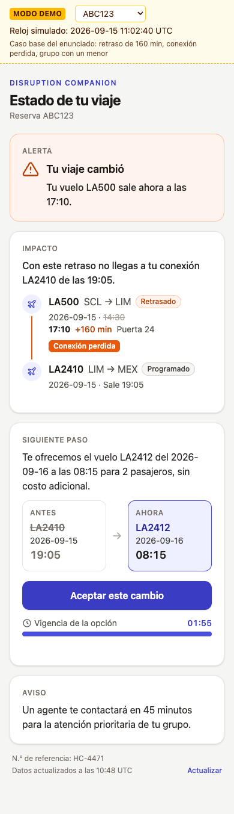
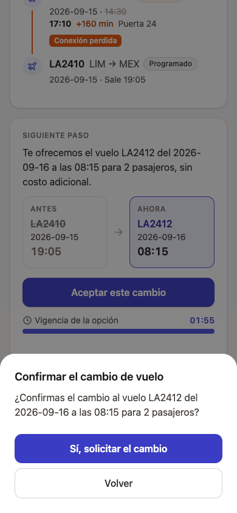
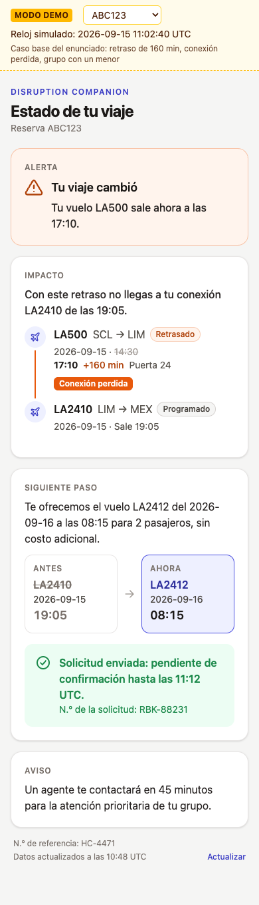
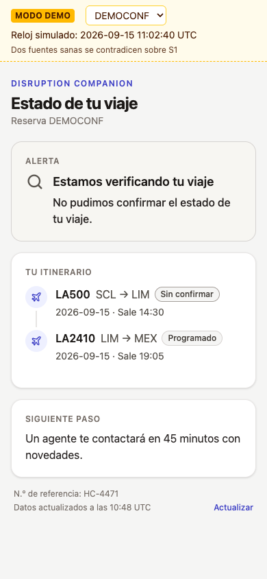
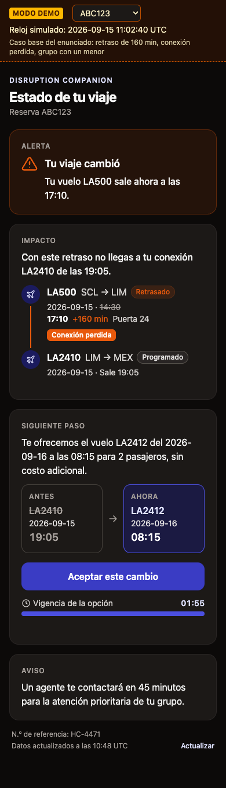

# Entregable 1 — Evidencia técnica

Vertical slice del **track Backend/Integración**, con la capa complementaria (la pantalla del
pasajero) implementada además de especificada. El README de ingeniería está en [`README.md`](README.md).

## Track elegido y por qué
**Backend/Integración** ([ADR-001](brain/architecture/adr/ADR-001-track-backend-integracion.md)).
El enunciado pide determinar qué ocurrió y qué le corresponde al pasajero: sólo el backend permite
**demostrarlo con tests** en lugar de asumirlo en un contrato. Además, ahí viven los casos difíciles
del caso base: fuentes contradictorias, conexión perdida, menor en el grupo, opciones inviables,
503 indeterminado y mensaje sin `policy_ref`. Stack: TypeScript + Node 24, `node:http` sin framework
([ADR-002](brain/architecture/adr/ADR-002-stack-typescript-node.md)).

## Alcance implementado

| HU | Qué hace | Estado |
|---|---|---|
| HU-001 | Estado verificado del viaje: consolidar eventos por fuente, frescura y conflicto | Implementada |
| HU-002 | Impacto: conexión perdida (llegada estimada + MCT frente a la siguiente salida) | Implementada |
| HU-003 | Entitlements según la política vigente; cada uno con su propia aprobación (RN-07) | Implementada |
| HU-004 | Una sola opción válida para todo el grupo, con descartes de motivo cerrado | Implementada |
| HU-005 | Derivación a una persona con evidencia sin datos personales | Implementada |
| HU-006 | Notificación validada (plantilla con `policy_ref`) | Implementada sobre el mock |
| HU-007 | Aceptar la opción: idempotencia, 409, 503 indeterminado, vencimiento | Implementada |
| HU-008 | Registro de decisiones sin datos personales | Implementada (log estructurado) |
| HU-009 | Consulta en lenguaje libre | Diseño: [`Docs/20`](Docs/20-consulta-compleja.md) |
| HU-010 | Pantalla del pasajero | Implementada en React, con mejoras de UX (UX-01) |

Backlog completo: [`brain/backlog/`](brain/backlog/README.md). Contrato de salida:
[`DisruptionAssessment` v1.0](Docs/16-contrato-disruption-assessment.md).

## Correrlo en local

Requiere Node 24.

```bash
cd web && npm install && npm test && npm run build      # pantalla → web/dist
cd ../engine && npm install && npm test && npm run build && npm start
```

Abrir **http://localhost:8080**. Enlace directo a una reserva: `/?booking=DEMOCONF`.

```bash
curl -i localhost:8080/v1/bookings/ABC123/disruption-assessment
curl -X POST localhost:8080/v1/bookings/ABC123/rebooking-requests \
  -H 'content-type: application/json' -d '{"decision_id":"dec_01JB7Q3M8K2V","option_id":"O1"}'
```

Con Docker (un contenedor con API y pantalla): `docker build -t disruption . && docker run -p 8080:8080 disruption`.

## Reservas de demostración

| Reserva | Qué muestra | Resultado |
|---|---|---|
| `ABC123` | Caso base: retraso de 160 min, fuente degradada, conexión perdida, menor en el grupo | `RELEVANT_CHANGE`, O1 (R3), R5 derivada en paralelo (`APPROVAL_REQUIRED`) |
| `DEMOCONF` | Dos fuentes sanas se contradicen sobre S1 | `UNVERIFIED`, `WAIT_FOR_AGENT`, `SOURCE_CONFLICT` |
| `DEMONOEV` | No hay eventos operacionales | `UNVERIFIED` (nunca "sin cambios"), `INCOMPLETE_DATA` |

**Reloj simulado:** las opciones del enunciado valen 120 s desde el 2026-09-15; cada escenario usa
un reloj fijo, declarado en el encabezado `X-Simulated-Clock`.

## API

| Método y ruta | Respuesta |
|---|---|
| `GET /v1/bookings/{id}/disruption-assessment` | 200 `DisruptionAssessment` · 400 · 404 · 500. Una falla de lectura da 200 `UNVERIFIED` + `READ_FAILURE` |
| `POST /v1/bookings/{id}/rebooking-requests` | 201 creada · 200 duplicado · 202 indeterminado · 400 · 404 · 410 vencida · 422 no recomendada ([contrato](brain/contracts/disruption-api.md)) |
| `GET /v1/scenarios` · `GET /health` · `GET /` | Reservas de demostración · estado · pantalla |

## Cómo decide

```
get_trip_context ─┐
get_operational_events ─► consolidar ─► impacto ─► política ─► opciones ─► control ─► mensaje ─► invariantes
get_policy_rules ─┘                                                ▲
get_eligible_options ──────────────────────────────────────────────┘
                     └► create_human_case (por derivación) ─► notify_passenger
```

El dominio (`engine/src/domain/`) son funciones puras, un archivo por paso: no hacen I/O ni leen el
reloj. Las 7 tools están detrás de un puerto (`ports/tools.ts`); hoy el adaptador es un mock con los
datos del enunciado, y conectar los sistemas reales cambia sólo el adaptador. Antes de responder se
verifican las 10 invariantes del contrato.

## Tests y validaciones

| Paquete | Comando | Qué cubre |
|---|---|---|
| `engine/` | `npm test` (51) | Un test por escenario de cada `.feature`, salida de `ABC123` igual al fixture del contrato, 10 invariantes, unitarios por paso, idempotencia (FALLA-001), ausencia de datos personales |
| `web/` | `npm test` (41) | View model, interacción con jsdom (confirmar, modal accesible, vigencia, errores), campos prohibidos |
| `web/` | `npm run test:e2e` (3) | Playwright en Chrome: recorrido de `ABC123` hasta "pendiente de confirmación", capturas, movimiento reducido |

Especificación ejecutable: [`brain/features/`](brain/features/). Los fixtures de la pantalla los
genera el motor real y un test verifica que sigan siendo idénticos.

| Caso base en móvil | Confirmación | Solicitud enviada | Sin confirmar | Modo oscuro |
|---|---|---|---|---|
|  |  |  |  |  |

## Capa complementaria
- **Especificación:** [`passenger-experience.md`](brain/contracts/passenger-experience.md): textos
  por plantilla, qué ve y qué no ve el pasajero.
- **Implementación:** `web/` (React 19 + Vite 8 + Tailwind 4, [ADR-010](brain/architecture/adr/ADR-010-pantalla-react-paquete-web.md)).
  Sólo lee el contrato: no calcula entitlements ni conexiones. Nunca dice "confirmado": la solicitud
  queda "pendiente de confirmación".

## Limitaciones conocidas
- 3 reservas de demostración. Opciones vencidas, política reemplazada, regla desconocida y sin
  opción viable sólo están cubiertas por tests.
- Sin autenticación: el 404 por "reserva de otro titular" no se ejercita.
- Si `get_policy_rules` falla, responde 500: sin política no hay mensaje validado (H-29).
- Un campo faltante nunca se clasifica como crítico (H-37).
- Las escrituras se deduplican por `decision_id` en el mock, y en la demo ese id es fijo (H-30, H-31).
- Horas `_local` comparadas sin zona horaria; MCT 0 min configurable (H-07).
- Solicitudes en memoria: se pierden al reiniciar. La vigencia corre desde que carga la pantalla (H-33).
- Pantalla sólo en español, con un canal de contacto genérico (H-32); e2e sólo en Chrome (H-35).
