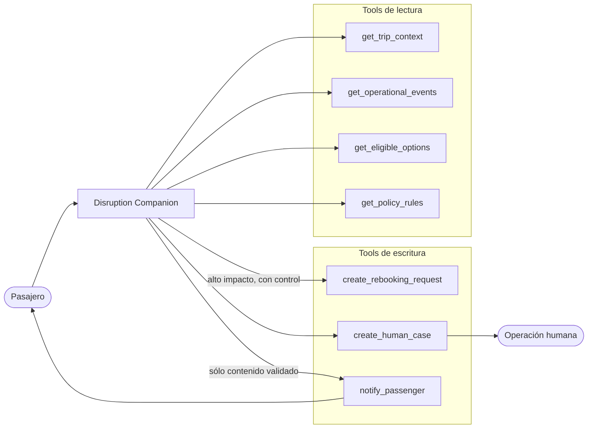
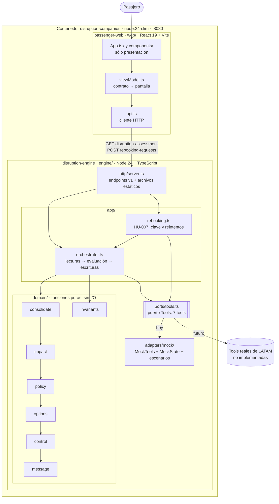
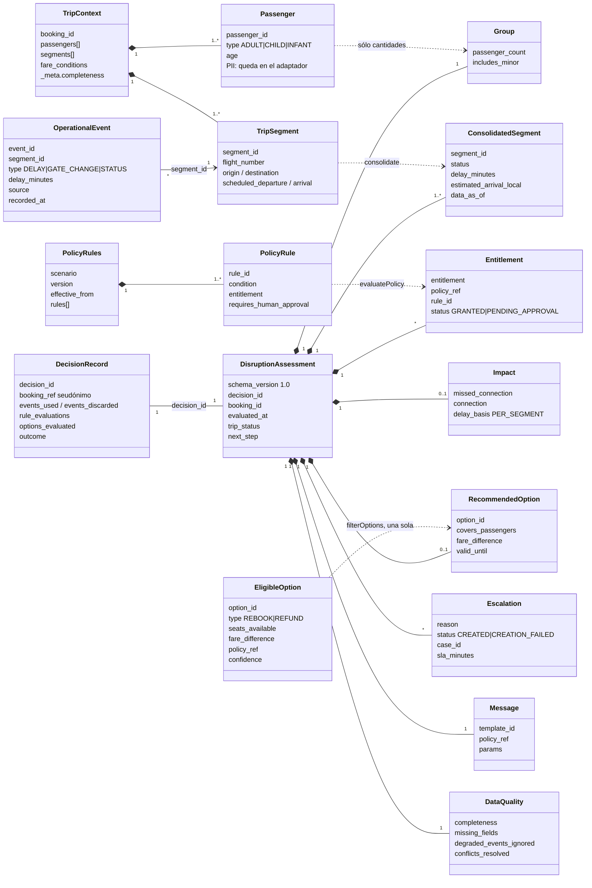
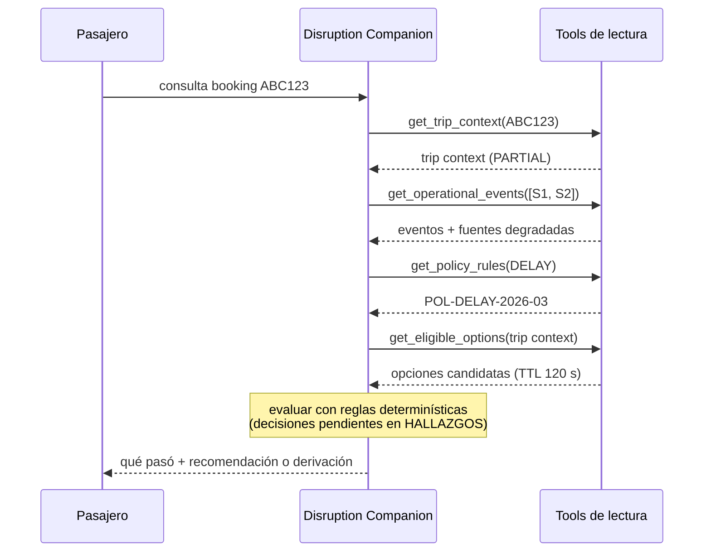

# Diagramas

> Validarlos con un parser (`npx -y @mermaid-js/mermaid-cli`), no sólo en la vista previa.
> Si cambia un componente, un endpoint o un tipo del contrato, se actualiza el diagrama en el mismo commit.

## Contexto (C4 nivel 1) — sistemas externos dados por el enunciado

## Contenedores y componentes (C4 niveles 2 y 3) — lo implementado

Un solo contenedor (`Dockerfile`, `node:24-slim`, puerto 8080): el motor sirve la API y la pantalla
compilada. Las tools reales no están implementadas; el puerto `Tools` las reemplaza por mocks con los
fixtures del enunciado (`contracts/fixtures/`).

| Endpoint | Componente | Contrato |
|---|---|---|
| `GET /v1/bookings/{id}/disruption-assessment` | `orchestrator.ts` | `contracts/disruption-api.md` |
| `POST /v1/bookings/{id}/rebooking-requests` | `rebooking.ts` | `contracts/disruption-api.md` (HU-007) |
| `GET /v1/scenarios`, `GET /health` | `server.ts` | `contracts/disruption-api.md` |
| `GET /*` (pantalla compilada) | `server.ts` sirve `web/dist` | — |

## Modelo de datos — entrada, decisión y salida

Fuente: `engine/src/domain/types.ts`. A la izquierda lo que entregan las tools (`contracts/tools-api.md`);
al centro la decisión; a la derecha el contrato de salida (`DisruptionAssessment` v1.0) y el registro
interno (HU-008), que nunca viaja al consumidor.

Las descartadas y sus motivos (`OptionEvaluation`), las reglas evaluadas (`RuleEvaluation`) y los
eventos descartados (`DiscardedEvent`) viven sólo en `DecisionRecord` (invariante 6 de
`contracts/disruption-assessment.md`). Ningún tipo de salida tiene datos personales (invariante 7).

## Caso base — secuencia de datos (sin decisiones de diseño todavía)

## Flujo de decisión y caso base resuelto
Ver `../product/08-flujo.md` (flujo de 7 etapas, caso `ABC123` paso a paso, consulta compleja y
puntos de escalabilidad).
