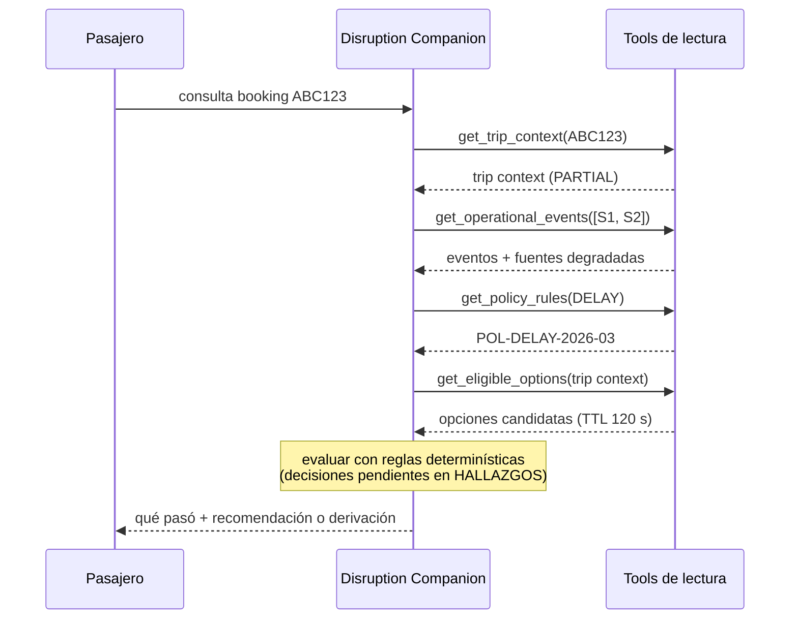

# Diagramas

> Track Backend (ADR-001): agregar la vista de contenedores de `disruption-engine` al crear el componente. Validarlos con un parser (`npx @mermaid-js/mermaid-cli`),
> no sólo en la vista previa.

## Contexto (C4 nivel 1) — sistemas externos dados por el enunciado

## Caso base — secuencia de datos (sin decisiones de diseño todavía)

## Flujo de decisión y caso base resuelto
Ver `../product/07-flujo.md` (flujo de 7 etapas, caso `ABC123` paso a paso, consulta compleja y
puntos de escalabilidad).
