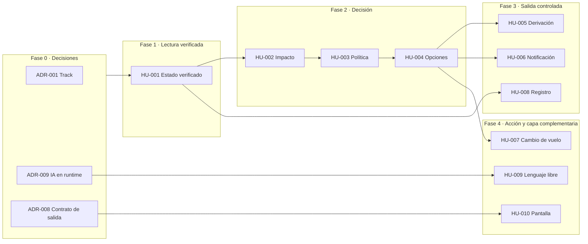

# EP-01 · Asistencia al pasajero ante una modificación de vuelo

- **Estado:** En curso (HU-001 a HU-008 y HU-010 en Pre-entrega; HU-009 en diseño)
- **Objetivo de negocio:** los cuatro objetivos de la V1 (`GLOBAL_AGENT_CONTEXT.md` §2): que todo
  pasajero con una modificación en su viaje sepa, sin llamar, qué pasó y cuál es su siguiente paso,
  con información verificada y trazada a la política vigente.
- **Métrica de éxito:**
  - **OV-1 · Contención (resultado):** tasa de contacto al call center dentro de las 24 h siguientes
    a la respuesta. Meta supuesta: −20 % frente a la línea base (H-16).
  - **OV-2 · Exactitud (límite):** tasa de recomendación incorrecta. Meta derivada del punto de
    equilibrio entre ahorro por contacto y costo por error (`Docs/10` §10.5); el 1 % es un marcador.
    Además, **0 acciones de alto impacto sin control** (meta absoluta).
  - Ambas se calculan desde el registro de decisiones (HU-008).

> Copia limpia para el comité: `../../Docs/epica/EP-01-asistencia-ante-modificacion-de-vuelo.md`.
> **Este archivo y los `HU-0XX-*.md` mandan**; la copia se regenera desde acá.

## Descripción
Cuando un vuelo de la reserva sufre una modificación, el pasajero consulta su reserva y el sistema
le dice **qué pasó, qué le implica y cuál es su siguiente paso**: aceptar una opción de cambio, esperar
a un agente o no hacer nada. Combina la reserva, los eventos operacionales y la política vigente con
lógica determinística, y deriva a una persona todo lo que no puede decidir con seguridad.

## Alcance
**Incluye**
- Escenario `DELAY` y su consecuencia, la conexión perdida: es la única política del enunciado.
- La reserva completa como unidad (todos los pasajeros del booking).
- Recomendación de cambio de vuelo sin costo, filtrada contra la política, el grupo y la vigencia.
- Derivación a una persona con evidencia, y notificación sólo con contenido validado.
- Solicitud de cambio de vuelo controlada.

**No incluye**
- Cancelación, desvío o cambio de equipo: no hay política ni tipo de evento en el enunciado.
- Compensación en dinero automática: `POL-DELAY-2026-03/R4` exige aprobación humana.
- Confirmación y emisión final del nuevo ticket (H-10).
- Hotel o alojamiento por pernocta (H-15).
- Chat libre de varios turnos, varios canales y dashboard de métricas.

## Historias

| ID | Título | Capacidad | Prioridad | Estado |
|---|---|---|---|---|
| [HU-001](HU-001-estado-verificado-del-viaje.md) | Ver el estado verificado de mi viaje | C1, C2 | Alta | Pre-entrega |
| [HU-002](HU-002-impacto-de-la-modificacion.md) | Saber si la modificación me afecta | C2 | Alta | Pre-entrega |
| [HU-003](HU-003-entitlements-segun-politica.md) | Saber qué me corresponde según la política vigente | C3 | Alta | Pre-entrega |
| [HU-004](HU-004-opcion-valida-para-el-grupo.md) | Recibir una opción de cambio válida para todo mi grupo | C3 | Alta | Pre-entrega |
| [HU-005](HU-005-derivacion-con-evidencia.md) | Ser derivado a una persona con mi caso ya explicado | C4 | Alta | Pre-entrega |
| [HU-006](HU-006-notificacion-validada.md) | Recibir una notificación clara y validada | C3 | Media | Pre-entrega |
| [HU-007](HU-007-solicitud-de-cambio-segura.md) | Solicitar el cambio de vuelo de forma segura (alto impacto) | C4 | Media | Pre-entrega |
| [HU-008](HU-008-registro-de-decisiones.md) | Registrar cada decisión de forma trazable y sin datos personales | Transversal | Alta | Pre-entrega |
| [HU-009](HU-009-consulta-en-lenguaje-libre.md) | Entender una consulta escrita en lenguaje libre (diseño) | §5.2 | Baja | Borrador (diseño) |
| [HU-010](HU-010-pantalla-del-pasajero.md) | Ver en pantalla el estado, la alerta y la recomendación | §5.3 | Media | Pre-entrega |

Capacidades del enunciado: **C1** consultar el contexto del viaje · **C2** entender si hubo una
modificación relevante · **C3** recibir explicación o recomendación accionable · **C4** ser derivado
a una persona o iniciar una acción controlada.

## Definiciones que usan las HU
Viven en el Brain, no acá:
- Estados del viaje (`trip_status`), siguiente paso (`next_step`) y motivos de derivación:
  `../domain/ubiquitous-language.md` y `../contracts/disruption-api.md`.
- Supuestos con los que se escriben los criterios (relevancia, fuentes, conexión, filtro de
  opciones, idempotencia…): `../../HALLAZGOS.md` (H-01, H-05 a H-09, H-12, H-13, H-17).
  Si un supuesto cambia, se ajusta el parámetro y el criterio, no el diseño.

## ADR
| Decisión | ADR | Estado |
|---|---|---|
| Track del vertical slice y stack | ADR-001, ADR-002 | Aceptados |
| Sin IA en runtime (la épica original lo numeraba ADR-002) | ADR-009 | Aceptado |
| Pantalla React en `web/` | ADR-010 | Aceptado |
| Producto: de la POC a la propuesta | ADR-011 | Aceptado |
| Consolidación de eventos (H-05, H-06, H-07) | ADR-003 | Reservado, sin escribir |
| Evaluación de políticas con predicados por `rule_id` (H-13) | ADR-004 | Reservado, sin escribir |
| Matriz automático / humano (H-03, H-04, H-08, H-17) | ADR-005 | Reservado, sin escribir |
| Escrituras de alto impacto: idempotency key y 503 (H-10, H-12) | ADR-006 | Reservado, sin escribir |
| Datos personales y trazabilidad (H-02) | ADR-007 | Reservado, sin escribir |
| Contrato de salida `DisruptionAssessment` | ADR-008 | Reservado, sin escribir |

## Mapa de ruta

**Corte contra el presupuesto.** El corte vigente y la priorización MVP / fase 2 están en `Docs/13`
§13.1 y §13.3. Orden de recorte si falta tiempo: HU-009 → HU-007 → HU-006 → HU-010. El núcleo
(HU-001 a HU-005 y HU-008) no se recorta. Desvío respecto del corte original: HU-007 y HU-010 se
implementaron (estaban previstas como pseudocódigo y especificación).

## Definición de terminado
1. El caso base `ABC123` produce, de punta a punta: S1 retrasado 160 min, conexión perdida, R3 y R5
   aplicadas, O1 recomendada, O2 y O3 descartadas con motivo, y un caso humano por R5.
2. Cada criterio **(neg)** del vertical slice tiene un test.
3. Ninguna recomendación sale sin `policy_ref`, y ningún registro contiene datos personales.
4. Lo que no se implementó está entregado como diseño, contrato o pseudocódigo, con sus limitaciones.
5. Los supuestos están documentados en `HALLAZGOS.md` con su pregunta y a quién se le haría.

> El punto 2 no se cumple todavía: cada HU lista en **Validación** los criterios sin test identificado.

## Preguntas abiertas que pueden cambiar la épica
- **H-01 y H-04 (negocio):** si "relevante" o "cuándo interviene una persona" cambian, se ajustan HU-002 y HU-005.
- **H-05 (operaciones):** el umbral de frescura es el parámetro más sensible para OV-2.
- **H-17b (negocio):** si R5 debe bloquear todo el caso, HU-004 deja de recomendar en automático
  cuando hay un menor en el grupo (RN-07).
- **H-16 (analítica):** sin línea base, las metas de OV-1 y OV-2 siguen siendo hipótesis.

## Historial
- 2026-10-29 — creada en `Docs/epica/` (sesión de producto).
- 2026-10-29 — `b204ab7` feat(EP-01): backend y pantalla del pasajero.
- 2026-10-30 — integrada al backlog del Brain (ENH-003); `Docs/epica/` pasa a ser copia derivada.
