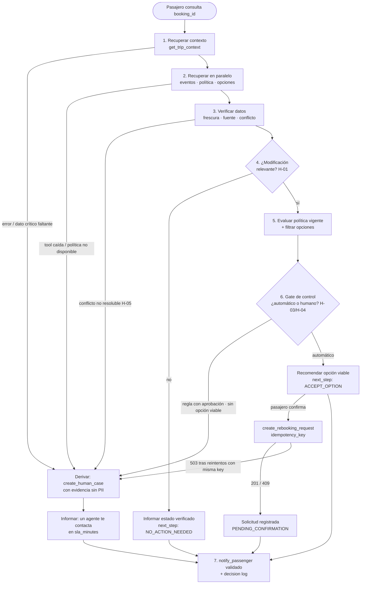

# 7. Flujo

> Flujo deducido del enunciado. Las decisiones que dependen de ambigüedades abiertas están marcadas
> con su `H-XX`; el flujo funciona igual con cualquier opción que se elija, sólo cambia el umbral.

## 7.1 Flujo general (7 etapas)

**Determinístico:** etapas 1–6 completas. **Humano:** salida `H`. **IA (opcional, D-03):** sólo
interpretar una consulta libre antes de la etapa 1 y redactar sobre plantilla en la etapa 7.

## 7.2 Caso base resuelto con los datos del enunciado (`ABC123`)

| Etapa | Dato | Resultado |
|---|---|---|
| 1. Contexto | 2 pasajeros (María ADULT, Tomás CHILD 7) · S1 SCL→LIM 14:30–17:55 · S2 LIM→MEX 19:05–23:40 · `PARTIAL` (falta `change_penalty_amount`) | Grupo con menor. Dato faltante **no crítico** si el entitlement es sin costo (H-09) |
| 3. Verificación | S1: `DELAY` 160 min (OPS_CORE 10:48) vs `ON_TIME` (LEGACY_MIRROR 09:30, **degradada** y más antigua) | Se descarta `LEGACY_MIRROR` → **S1 retrasado 160 min**, nueva salida 17:10 (H-05) |
| | S1: `GATE_CHANGE` puerta 24 (AIRPORT_FEED) | Informativo |
| | S2: `SCHEDULED` (OPS_CORE) | Sin cambio |
| 4. Relevancia | Llegada estimada S1 ≈ 17:55 + 160 min = **20:35** > salida S2 19:05 | **Conexión perdida → modificación relevante** (H-07: falta tiempo mínimo de conexión y zona horaria; aquí se pierde igual) |
| 5. Política `POL-DELAY-2026-03` | R1 (≥180): **no** (160) · R2 (≥240 e intl.): **no** · R3 (`missed_connection`): **sí** → `REBOOK_NO_FEE` · R4: sólo si el pasajero pide compensación (H-14) · R5 (menor en el grupo): **sí** → `PRIORITY_HANDLING`, **requiere humano** | Entitlements: rebooking sin costo + atención prioritaria con aprobación |
| 5. Opciones | O1 LA2412 16-09 08:15, diferencia 0, 4 asientos, HIGH · O2 LA2450 15-09 23:40, 180000 CLP, **1 asiento** · O3 REFUND, tarifa **no reembolsable**, LOW | **O1 viable.** O2 descartada (asientos < 2 y costo contradice `REBOOK_NO_FEE`). O3 descartada (tarifa y confianza) (H-08) |
| 6. Gate | R5 exige aprobación humana | 💡 **Propuesta conservadora:** se informa y se recomienda O1 automáticamente (R3 no requiere aprobación) y **en paralelo** se crea el caso `APPROVAL_REQUIRED` por R5. Alternativa: todo el caso a humano. **Decide el usuario (H-17)** |
| 7. Comunicación | — | "Tu vuelo LA500 sale con retraso a las 17:10 y no alcanzarás tu conexión LA2410. Te corresponde un cambio sin costo: LA2412 del 16-09 a las 08:15 para ambos pasajeros. Como viajas con un menor, un agente te contactará para darte atención prioritaria." + `policy_ref` |

**Hallazgo del caso base:** con O1 la llegada a MEX pasa al día siguiente (≈ 13 h de retraso a
destino). Si el retraso se midiera a destino final (H-06), aplicarían también R1 y R2
(`MEAL_VOUCHER`), y hay pernocta en LIM sin regla de hotel en la política (H-15).

## 7.3 Consulta ambigua o compleja (§5.2 del enunciado)
Ejemplo: *"Mi vuelo está atrasado, ¿pierdo la conexión? Quiero que me compensen."*

| Paso | Qué hace | Clasificación |
|---|---|---|
| 1 | Extraer intención: `CHECK_CONNECTION` + `compensation_requested = true` | IA-assisted (o formulario con botones en la V1) |
| 2 | Recuperar contexto, eventos, política y opciones | Determinístico |
| 3 | Calcular conexión perdida y evaluar R1–R5 | Determinístico |
| 4 | R4 (`CASH_COMPENSATION`) requiere aprobación → **se detiene** | Humano |
| 5 | Responder lo verificado (conexión perdida, O1) y derivar la compensación con evidencia | Determinístico (plantilla) |

El modelo, si existe, **nunca** decide un entitlement ni llama tools de escritura: sólo traduce
lenguaje natural a una intención de un catálogo cerrado. Si la intención no se reconoce, se pregunta
con opciones cerradas o se deriva.

## 7.4 Escalabilidad sin complejizar la V1
| Eje | V1 (lo mínimo) | Punto de extensión declarado |
|---|---|---|
| Nuevos escenarios (cancelación, desvío) | Sólo `DELAY` | Registro de evaluadores por escenario: `scenario → predicados por rule_id`. Agregar uno no toca el orquestador |
| Nuevas versiones de política | Predicados por `rule_id` + versión | Reglas desconocidas van a humano hasta tener predicado: el sistema no falla, se vuelve conservador |
| Nuevas fuentes operacionales | Prioridad por estado (sana > degradada) + recencia | Tabla de confiabilidad por fuente configurable |
| Volumen (disrupción masiva, muchos bookings a la vez) | Orquestador sin estado; lecturas en paralelo | Cache de lecturas respetando `ttl_seconds`; cola para escrituras y notificaciones; escalado horizontal |
| Canales | `PUSH` vía `notify_passenger` | Plantillas por canal sobre el mismo `DisruptionAssessment` |
| Operación | Decision log único | Las métricas OV-1/OV-2 salen del log; dashboard después |
